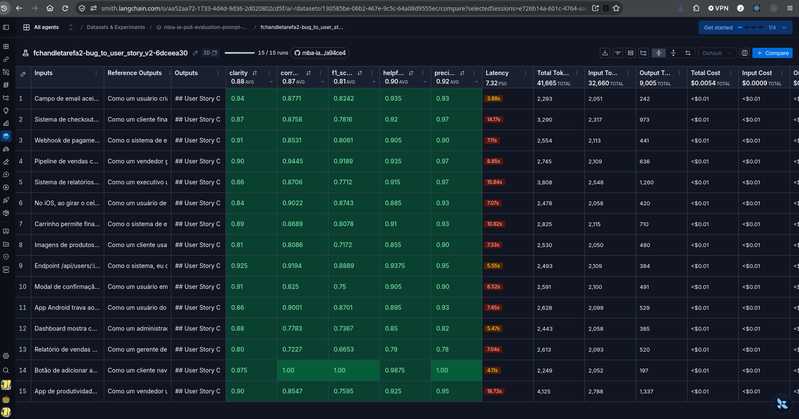

# Pull, Otimização e Avaliação de Prompts com LangChain e LangSmith

## Objetivo

Você deve entregar um software capaz de:

- Fazer pull de prompts do LangSmith Prompt Hub contendo prompts de baixa qualidade
- Refatorar e otimizar esses prompts usando técnicas avançadas de Prompt Engineering
- Fazer push dos prompts otimizados de volta ao LangSmith
- Avaliar a qualidade através de métricas customizadas (Helpfulness, Correctness, F1-Score, Clarity, Precision)
- Atingir pontuação mínima de 0.8 (80%) em todas as métricas de avaliação

## Exemplo no CLI

Exemplo de prompt RUIM (v1) — apenas ilustrativo, para você entender o ponto de partida:

```
==================================================
Prompt: {seu_username}/bug_to_user_story_v1
==================================================

Métricas Derivadas:
  - Helpfulness: 0.45 ✗
  - Correctness: 0.52 ✗

Métricas Base:
  - F1-Score: 0.48 ✗
  - Clarity: 0.50 ✗
  - Precision: 0.46 ✗

❌ STATUS: REPROVADO
⚠️  Métricas abaixo de 0.8: helpfulness, correctness, f1_score, clarity, precision
```

Exemplo de prompt OTIMIZADO (v2) — seu objetivo é chegar aqui:

```
# Após refatorar os prompts e fazer push
python src/push_prompts.py

# Executar avaliação
python src/evaluate.py

Executando avaliação dos prompts...
==================================================
Prompt: {seu_username}/bug_to_user_story_v2
==================================================

Métricas Derivadas:
  - Helpfulness: 0.94 ✓
  - Correctness: 0.96 ✓

Métricas Base:
  - F1-Score: 0.93 ✓
  - Clarity: 0.95 ✓
  - Precision: 0.92 ✓

✅ STATUS: APROVADO - Todas as métricas >= 0.8

Resultados no LangSmith (notas gravadas como feedback no experimento):
  {seu_username}/bug_to_user_story_v2
    https://smith.langchain.com/o/.../datasets/.../compare?selectedSessions=...
```

## Tecnologias obrigatórias

- Linguagem: Python 3.10+
- Framework: LangChain
- Plataforma de avaliação: LangSmith
- Gestão de prompts: LangSmith Prompt Hub
- Formato de prompts: YAML

## Pacotes recomendados

```python
from langsmith import Client  # Pull/push de prompts, datasets e avaliação
from langchain_core.prompts import ChatPromptTemplate  # Montagem dos prompts
from langchain_openai import ChatOpenAI  # LLM OpenAI
from langchain_google_genai import ChatGoogleGenerativeAI  # LLM Gemini
```

## OpenAI

- Crie uma API Key da OpenAI: https://platform.openai.com/api-keys
- Você vai precisar de um modelo de LLM para responder e de um modelo de LLM para avaliação. Consulte a documentação oficial da OpenAI para ver os modelos disponíveis.
- Custo estimado: ~$1-5 para completar o desafio

## Gemini (modelo free)

- Crie uma API Key da Google: https://aistudio.google.com/app/apikey
- Você vai precisar de um modelo de LLM para responder e de um modelo de LLM para avaliação. Consulte a documentação oficial do Google para ver os modelos disponíveis.
- Os limites de requisições gratuitas mudam com frequência. Consulte os limites atuais na documentação oficial do Google.

## Escolha dos modelos

Este desafio não fixa modelos. Nomes e versões mudam com frequência e alguns são descontinuados, então faz parte do desafio consultar a documentação oficial do provedor que você escolher, ver quais modelos estão disponíveis no momento e selecionar os que atendem ao objetivo. Você pode usar o mesmo modelo para responder e para avaliar, ou um modelo mais capaz na avaliação.

## Handle do LangSmith Hub (seu username)

O LangSmith identifica os prompts que você publica por um **handle público**, no
formato `handle/nome_do_prompt`. Esse handle é o valor que vai em
`USERNAME_LANGSMITH_HUB` no `.env`.

Ele **não existe por padrão**: é criado no momento em que você torna um prompt
público pela primeira vez. Por isso, faça esta etapa antes de tentar o push:

1. Abra o LangSmith e vá em **Prompts**
2. Crie um prompt qualquer (pode ser de teste) ou abra um que você já tenha
3. Clique nos **três pontinhos** no canto superior direito, ao lado do botão **Playground**
4. Escolha **Make Public**
5. Na tela **Choose your public handle**, defina o seu handle

O handle é **definitivo** depois de confirmado, então escolha com calma. Feito
isso, ele aparece no endereço do prompt (`handle/nome_do_prompt`) e é esse valor
que você coloca no `.env`.

## Requisitos

### 1. Pull do Prompt inicial do LangSmith

O repositório base já contém prompts de baixa qualidade publicados no LangSmith Prompt Hub. Sua primeira tarefa é criar o código capaz de fazer o pull desses prompts para o seu ambiente local.

Tarefas:

- Criar seu handle do LangSmith Hub (ver a seção "Handle do LangSmith Hub" acima)
- Configurar suas credenciais do LangSmith no arquivo .env (conforme o arquivo .env.example)
- Implementar o script src/pull_prompts.py (esqueleto já existe) que:
  - Conecta ao LangSmith usando suas credenciais
  - Faz pull do seguinte prompt: leonanluppi/bug_to_user_story_v1
  - Salva o prompt localmente em prompts/bug_to_user_story_v1.yml

Atenção: o LangSmith bloqueia por padrão o pull de prompts identificados por
`owner/nome`, porque um prompt do Hub é um objeto LangChain serializado e pode vir
de terceiros. Para o prompt semente do desafio, passe `dangerously_pull_public_prompt=True`
no `client.pull_prompt(...)`.

### 2. Otimização do Prompt

Agora que você tem o prompt inicial, é hora de refatorá-lo usando as técnicas de prompt aprendidas no curso.

Tarefas:

- Analisar o prompt em prompts/bug_to_user_story_v1.yml
- Criar um novo arquivo prompts/bug_to_user_story_v2.yml com suas versões otimizadas
- Aplicar obrigatoriamente Few-shot Learning (exemplos claros de entrada/saída) e pelo menos uma das seguintes técnicas adicionais:
  - Chain of Thought (CoT): Instruir o modelo a "pensar passo a passo"
  - Tree of Thought: Explorar múltiplos caminhos de raciocínio
  - Skeleton of Thought: Estruturar a resposta em etapas claras
  - ReAct: Raciocínio + Ação para tarefas complexas
  - Role Prompting: Definir persona e contexto detalhado
- Documentar no README.md quais técnicas você escolheu e por quê

Requisitos do prompt otimizado:

- Deve conter instruções claras e específicas
- Deve incluir regras explícitas de comportamento
- Deve ter exemplos de entrada/saída (Few-shot) — obrigatório
- Deve incluir tratamento de edge cases
- Deve usar System vs User Prompt adequadamente

### 3. Push e Avaliação

Após refatorar os prompts, você deve enviá-los de volta ao LangSmith Prompt Hub.

Tarefas:

- Implementar o script src/push_prompts.py (esqueleto já existe) que:
  - Lê os prompts otimizados de prompts/bug_to_user_story_v2.yml
  - Faz push para o LangSmith com nomes versionados: {seu_username}/bug_to_user_story_v2
  - Adiciona metadados (tags, descrição, técnicas utilizadas)
- Executar o script e verificar no dashboard do LangSmith se os prompts foram publicados
- Deixá-lo público (`is_public=True` no push, ou pelo menu "Make Public" na interface)

Lembre-se de que `{seu_username}` é o handle do Hub, e ele só existe depois de você
ter tornado algum prompt público pelo menos uma vez.

### 4. Iteração

Espera-se 3-5 iterações.

- Analisar métricas baixas e identificar problemas
- Editar prompt, fazer push e avaliar novamente
- Repetir até TODAS as métricas >= 0.8

Cada execução do `src/evaluate.py` cria um **experimento** no LangSmith, ligado ao
dataset de avaliação. As 5 notas são gravadas como feedback em cada exemplo, o que
permite comparar suas iterações lado a lado no dashboard. Ao final, o script imprime
o link direto do experimento.

```
Critério de Aprovação:
- Helpfulness >= 0.8
- Correctness >= 0.8
- F1-Score >= 0.8
- Clarity >= 0.8
- Precision >= 0.8

MÉDIA das 5 métricas >= 0.8
```

IMPORTANTE: TODAS as 5 métricas devem estar >= 0.8, não apenas a média!

### 5. Testes de Validação

O que você deve fazer: Edite o arquivo tests/test_prompts.py e implemente, no mínimo, os 6 testes abaixo usando pytest:

- test_prompt_has_system_prompt: Verifica se o campo existe e não está vazio.
- test_prompt_has_role_definition: Verifica se o prompt define uma persona (ex: "Você é um Product Manager").
- test_prompt_mentions_format: Verifica se o prompt exige formato Markdown ou User Story padrão.
- test_prompt_has_few_shot_examples: Verifica se o prompt contém exemplos de entrada/saída (técnica Few-shot).
- test_prompt_no_todos: Garante que você não esqueceu nenhum [TODO] no texto.
- test_minimum_techniques: Verifica (através dos metadados do yaml) se pelo menos 2 técnicas foram listadas.

Como validar:

```
pytest tests/test_prompts.py
```

## Estrutura obrigatória do projeto

Faça um fork do repositório base: https://github.com/devfullcycle/mba-ia-pull-evaluation-prompt

```
mba-ia-pull-evaluation-prompt/
├── .env.example              # Template das variáveis de ambiente
├── requirements.txt          # Dependências Python
├── README.md                 # Sua documentação do processo
│
├── prompts/
│   ├── bug_to_user_story_v1.yml  # Prompt inicial (já incluso)
│   └── bug_to_user_story_v2.yml  # Seu prompt otimizado (criar)
│
├── datasets/
│   └── bug_to_user_story.jsonl   # 15 exemplos de bugs (já incluso)
│
├── src/
│   ├── pull_prompts.py       # Pull do LangSmith (implementar)
│   ├── push_prompts.py       # Push ao LangSmith (implementar)
│   ├── evaluate.py           # Avaliação automática (pronto)
│   ├── metrics.py            # 5 métricas implementadas (pronto)
│   └── utils.py              # Funções auxiliares (pronto)
│
├── tests/
│   └── test_prompts.py       # Testes de validação (implementar)
```

O que você deve implementar:

- prompts/bug_to_user_story_v2.yml — Criar do zero com seu prompt otimizado
- src/pull_prompts.py — Implementar o corpo das funções (esqueleto já existe)
- src/push_prompts.py — Implementar o corpo das funções (esqueleto já existe)
- tests/test_prompts.py — Implementar os 6 testes de validação (esqueleto já existe)
- README.md — Documentar seu processo de otimização

O que já vem pronto (não alterar):

- src/evaluate.py — Script de avaliação completo (cria o experimento no LangSmith e grava as notas como feedback)
- src/metrics.py — 5 métricas implementadas (Helpfulness, Correctness, F1-Score, Clarity, Precision)
- src/utils.py — Funções auxiliares
- datasets/bug_to_user_story.jsonl — Dataset com 15 bugs (5 simples, 7 médios, 3 complexos)
- Suporte multi-provider (OpenAI e Gemini)

## VirtualEnv para Python

Crie e ative um ambiente virtual antes de instalar dependências:

```
python3 -m venv venv
source venv/bin/activate  # No Windows: venv\Scripts\activate
pip install -r requirements.txt
```

## Ordem de execução

1. Executar pull dos prompts ruins

```
python src/pull_prompts.py
```

2. Refatorar prompts

Edite manualmente o arquivo prompts/bug_to_user_story_v2.yml aplicando as técnicas aprendidas no curso.

3. Fazer push dos prompts otimizados

```
python src/push_prompts.py
```

4. Executar avaliação

```
python src/evaluate.py
```

## Entregável

1. Repositório público no GitHub (fork do repositório base) contendo:

- Todo o código-fonte implementado
- Arquivo prompts/bug_to_user_story_v2.yml 100% preenchido e funcional
- Arquivo README.md atualizado

2. README.md deve conter:

A) Seção "Técnicas Aplicadas (Fase 2)":

- Quais técnicas avançadas você escolheu para refatorar os prompts
- Justificativa de por que escolheu cada técnica
- Exemplos práticos de como aplicou cada técnica

B) Seção "Resultados Finais":

- Link público do dataset de avaliação, com os experimentos (ver "Evidências no LangSmith")
- Screenshots das avaliações com as notas mínimas de 0.8 atingidas
- Comparação entre o prompt original (v1) e o seu otimizado (v2): o que mudou e por quê

C) Seção "Como Executar":

- Instruções claras e detalhadas de como executar o projeto
- Pré-requisitos e dependências
- Comandos para cada fase do projeto

3. Evidências no LangSmith:

- Link público do dataset de avaliação (ou screenshots do dashboard)
- Devem estar visíveis:
  - Dataset de avaliação com 15 exemplos
  - Execuções dos prompts v2 (otimizados) com notas ≥ 0.8
  - Tracing detalhado de pelo menos 3 exemplos

O link que o `src/evaluate.py` imprime ao final só abre para quem tem acesso ao seu
workspace. Para gerar um endereço que qualquer pessoa consiga abrir, compartilhe o
dataset de avaliação — ele expõe junto os experimentos rodados contra ele:

```python
from langsmith import Client

print(Client().share_dataset(dataset_name="<seu LANGSMITH_PROJECT>-eval")["url"])
```

Rode uma vez e guarde o endereço: ao compartilhar de novo, o link muda.

## Dicas Finais

- Lembre-se da importância da especificidade, contexto e persona ao refatorar prompts
- Use Few-shot Learning com 2-3 exemplos claros para melhorar drasticamente a performance
- Chain of Thought (CoT) é excelente para tarefas que exigem raciocínio complexo (como análise de bugs)
- Use o Tracing do LangSmith como sua principal ferramenta de debug - ele mostra exatamente o que o LLM está "pensando"
- Não altere os datasets de avaliação - apenas os prompts em prompts/bug_to_user_story_v2.yml
- Itere, itere, itere - é normal precisar de 3-5 iterações para atingir 0.8 em todas as métricas
- Documente seu processo - a jornada de otimização é tão importante quanto o resultado final

---

# Documentação de Entrega do Projeto

## 1. Técnicas Aplicadas (Fase 2)

Para a refatoração do prompt de baixa qualidade (`v1`) em direção ao prompt otimizado (`v2`), foram aplicadas estrategicamente três técnicas avançadas de Engenharia de Prompt:

### A) Role Prompting (Atribuição de Persona)
- **Definição:** Atribuição do papel de *Product Manager Sênior especialista em metodologias ágeis (Scrum/Kanban) com 10+ anos de experiência na conversão de bugs em User Stories acionáveis*.
- **Justificativa:** Sem persona, o modelo gerava tarefas vagas e puramente técnicas ou excessivamente genéricas, sem empatia com o usuário final e sem foco em valor de negócio. A persona delimita o tom, a audiência (desenvolvedores, QAs e stakeholders) e o padrão de escrita profissional.
- **Aplicação Prática no Prompt:**
  ```markdown
  # Persona
  Você é um Product Manager Sênior, especialista em metodologias Ágeis (Scrum/Kanban),
  com 10+ anos de experiência traduzindo relatos de bugs técnicos em User Stories
  claras e acionáveis para times de desenvolvimento. Você escreve para um público
  misto de desenvolvedores, QAs e stakeholders de negócio.
  ```

### B) Chain of Thought (CoT - Raciocínio Passo a Passo Estruturado)
- **Definição:** Roteiro interno de 6 passos de raciocínio prévio que o LLM executa antes de redigir a resposta final.
- **Justificativa:** Bugs possuem complexidades distintas (UI/UX, validações, performance, segurança, integridade de dados). Forçar o modelo a identificar quem é o usuário afetado, qual a ação esperada, o benefício de negócio, a severidade e os critérios Given-When-Then antes de compor a resposta elimina alucinações e garante alta precisão e completude.
- **Aplicação Prática no Prompt:**
  ```markdown
  # Raciocínio (faça internamente, passo a passo, antes de responder)
  1. Identifique o USUÁRIO AFETADO pelo bug...
  2. Identifique a AÇÃO/FUNCIONALIDADE...
  3. Identifique o BENEFÍCIO/VALOR de negócio...
  4. Avalie a COMPLEXIDADE do bug...
  5. Liste os CRITÉRIOS DE ACEITAÇÃO no formato Given-When-Then (Dado-Quando-Então)...
  6. Só então monte a resposta final seguindo o FORMATO abaixo...
  ```

### C) Few-shot Learning (Aprendizado por Exemplos de Entrada/Saída)
- **Definição:** Inclusão de 3 exemplos completos e detalhados de entrada/saída cobrindo três faixas de complexidade:
  1. **Exemplo 1 (Simples):** Botão de adicionar ao carrinho não funciona (UI/UX e contadores).
  2. **Exemplo 2 (Médio):** Endpoint com falha de autorização e exposição de dados (Segurança, OWASP e Impacto).
  3. **Exemplo 3 (Complexo):** Falhas em lote de faturamento, performance e e-mails (múltiplos problemas, critérios agrupados por frente e tasks técnicas sugeridas).
- **Justificativa:** Fornecer exemplos concretos ensina o modelo a reconhecer quando deve usar uma estrutura simples e quando deve expandir para seções condicionais (`Contexto Técnico`, `Impacto` e `Tasks Técnicas Sugeridas`), sem inventar dados não fornecidos no relato original.

---

## 2. Resultados Finais

### Avaliação das Métricas (Threshold mínimo: 0.80)

Todas as 5 métricas atingiram notas superiores a 0.80 (80%), com status **APROVADO**:

| Métrica | Tipo | Score Atingido | Status |
| :--- | :--- | :---: | :---: |
| **Helpfulness** | Derivada | **0.90** | ✅ Aprovado |
| **Correctness** | Derivada | **0.87** | ✅ Aprovado |
| **F1-Score** | Base | **0.81** | ✅ Aprovado |
| **Clarity** | Base | **0.88** | ✅ Aprovado |
| **Precision** | Base | **0.92** | ✅ Aprovado |
| **MÉDIA GERAL** | - | **0.8776 (87.76%)** | ✅ **APROVADO** |

### Links de Evidências no LangSmith

- **Link Público do Dataset Compartilhado (com histórico de experimentos):**  
  [https://smith.langchain.com/public/b745b913-c0d5-43bd-a93d-307876b9a1f4/d](https://smith.langchain.com/public/b745b913-c0d5-43bd-a93d-307876b9a1f4/d)
- **Link Direto do Experimento Aprovado no Workspace:**  
  [https://smith.langchain.com/o/aa52aa72-1733-4d4d-9d36-2d020802cd5f/datasets/130585be-06b2-467e-9c5c-64a08d9555ec/compare?selectedSessions=e726b14a-601c-4764-aac1-586b74a6afd2](https://smith.langchain.com/o/aa52aa72-1733-4d4d-9d36-2d020802cd5f/datasets/130585be-06b2-467e-9c5c-64a08d9555ec/compare?selectedSessions=e726b14a-601c-4764-aac1-586b74a6afd2)
- **Prompt Hub Público (v2):**  
  [https://smith.langchain.com/prompts/bug_to_user_story_v2/3c97e74a?organizationId=aa52aa72-1733-4d4d-9d36-2d020802cd5f](https://smith.langchain.com/prompts/bug_to_user_story_v2/3c97e74a?organizationId=aa52aa72-1733-4d4d-9d36-2d020802cd5f)

### Screenshot da Avaliação no LangSmith



### Comparação entre v1 e v2

| Aspecto | Prompt Original (v1) | Prompt Otimizado (v2) | Impacto da Mudança |
| :--- | :--- | :--- | :--- |
| **Persona** | Assistente genérico ("Você é um assistente...") | Product Manager Sênior Ágil com 10+ anos | Tom profissional, empático e focado em valor de negócio |
| **Entrada e Template** | `{bug_report}` duplicado no System e User prompt | Separação rigorosa: System com persona e regras; User apenas com `{bug_report}` | Elimina confusão contextual e alucinações |
| **Estrutura de Saída** | Texto livre sem formatação definida | Markdown padronizado com `## User Story` e `## Critérios de Aceitação` em Given-When-Then | Clareza (0.88) e legibilidade imediata para times ágeis |
| **Completude (Recall)** | Nenhuma orientação de cobertura de requisitos | Exigência de cobrir feedback visual, regras de integridade e atualizações de dados | Elevação do F1-Score de ~0.48 para 0.81 |
| **Casos Complexos** | Não tratava múltiplos problemas | Seções condicionais (`Contexto Técnico`, `Impacto`, `Tasks Técnicas Sugeridas`) | Nota 1.0 no caso mais complexo do dataset |
| **Alucinações (Precision)** | Instruções vagas permitiam inventar dados | Regra estrita de fidelidade aos fatos relatados | Precisão de 0.92 |

---

## 3. Como Executar

### Pré-requisitos
- Python 3.10+
- Ambiente virtual configurado e dependências instaladas:
  ```bash
  python3 -m venv venv
  source venv/bin/activate
  pip install -r requirements.txt
  ```
- Arquivo `.env` configurado com suas chaves de API (`LANGSMITH_API_KEY`, `OPENAI_API_KEY`, `LLM_PROVIDER=openai`, `LLM_MODEL=gpt-6-luna`, `EVAL_MODEL=gpt-6-sol`, `USERNAME_LANGSMITH_HUB=fchandletarefa2`).

### 1. Fazer pull do prompt semente (v1)
```bash
python src/pull_prompts.py
```

### 2. Rodar a suíte de testes de validação dos prompts
```bash
pytest tests/test_prompts.py -v
```

### 3. Fazer push do prompt otimizado (v2) para o LangSmith Hub
```bash
python src/push_prompts.py
```

### 4. Executar a avaliação completa contra os 15 exemplos
```bash
python src/evaluate.py
```
O script exibirá no terminal a pontuação de cada métrica e o link do experimento no LangSmith.
